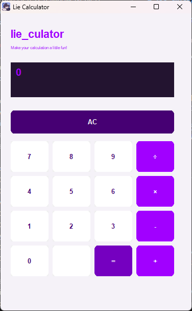

# lie_culator

**ちょっと遊び心のある、Windows向けデスクトップ電卓アプリ**

`lie_culator` は、C++ と Win32 API を使用して開発したWindows向け電卓アプリです。



## Overview

- Windows向けデスクトップアプリ
- C++ / Win32 API
- 独自のボタンデザイン
- 数値・四則演算・小数点に対応
- ReleaseビルドによるEXE配布に対応

## Features

- **四則演算**
  - 加算（+）
  - 減算（-）
  - 乗算（×）
  - 除算（÷）
- **数値入力**
  - 0〜9
  - 小数点
- **ACボタン**
  - 入力内容のクリア
- **計算式の表示**
  - 入力中の計算式を表示
- **独自UI**
  - カスタムカラー
  - オーナードローによるボタン描画

## Technology Stack

| 項目         | 技術                    |
| ------------ | ----------------------- |
| Language     | C++17                   |
| UI           | Win32 API               |
| Build System | CMake                   |
| IDE          | Qt Creator              |
| Compiler     | MinGW                   |
| Resource     | Windows Resource Script |

## Directory Structure

```text
lie_culator/
├── CMakeLists.txt
├── README.md
├── src/
│   ├── main.cpp
│   ├── resource.h
│   ├── assets/
│   │   └── owo_app_icon.ico
│   ├── logic/
│   │   ├── CalculatorLogic.h
│   │   └── CalculatorLogic.cpp
│   └── ui/
│       ├── CalculatorWindow.h
│       ├── CalculatorWindow.cpp
│       ├── components/
│       │   ├── CalculatorControls.h
│       │   └── CalculatorControls.cpp
│       ├── events/
│       │   ├── CalculatorEventHandler.h
│       │   └── CalculatorEventHandler.cpp
│       └── styles/
│           ├── CalculatorStyle.h
│           └── CalculatorStyle.cpp
└── resources/
    └── app.rc
```

## Architecture

表示・イベント・計算処理を分離した構成にしています。

```text
CalculatorWindow
      │
      ├── CalculatorControls
      │       └── 画面・ボタン生成
      │
      ├── CalculatorEventHandler
      │       └── ボタンイベント処理
      │
      ├── CalculatorStyle
      │       └── 色・フォント・描画
      │
      └── CalculatorLogic
              └── 計算ロジック
```

### Responsibility

| Class                  | Responsibility       |
| ---------------------- | -------------------- |
| CalculatorWindow       | ウィンドウ管理       |
| CalculatorControls     | UIコンポーネント生成 |
| CalculatorEventHandler | イベント処理         |
| CalculatorStyle        | UIスタイル・描画     |
| CalculatorLogic        | 計算処理             |

## Build

### Requirements

- Windows
- CMake
- MinGW-w64
- Qt Creator（開発時）

### Build with CMake

```bash
cmake -S . -B build -G "MinGW Makefiles" -DCMAKE_BUILD_TYPE=Release

cmake --build build --config Release
```

※ MinGWのコンパイラとCMakeにPATHが通っている必要があります。

### Build with Qt Creator

1. プロジェクトを開く
2. MinGWキットを選択
3. Build Configurationを `Release` に変更
4. CMakeを再構成
5. Buildを実行

## Distribution

Releaseビルドで生成された `calculator.exe` を使用します。

MinGWランタイムを静的リンクする設定を採用しています。

```cmake
if(MINGW)
    target_link_options(calculator PRIVATE
        -static
        -static-libgcc
        -static-libstdc++
    )
endif()
```

配布前に、開発環境とは異なるWindows環境での起動確認を推奨します。

## Purpose

C++とWin32 APIを使用したWindowsアプリケーション開発を通じて、以下を学習することを目的としています。

- Windows APIによるGUI開発
- C++によるクラス設計
- UIとロジックの責務分離
- イベント駆動型プログラミング
- CMakeによるビルド管理
- Windowsアプリケーションの配布

## License

未設定です。公開・配布する前にライセンスを決定してください。
